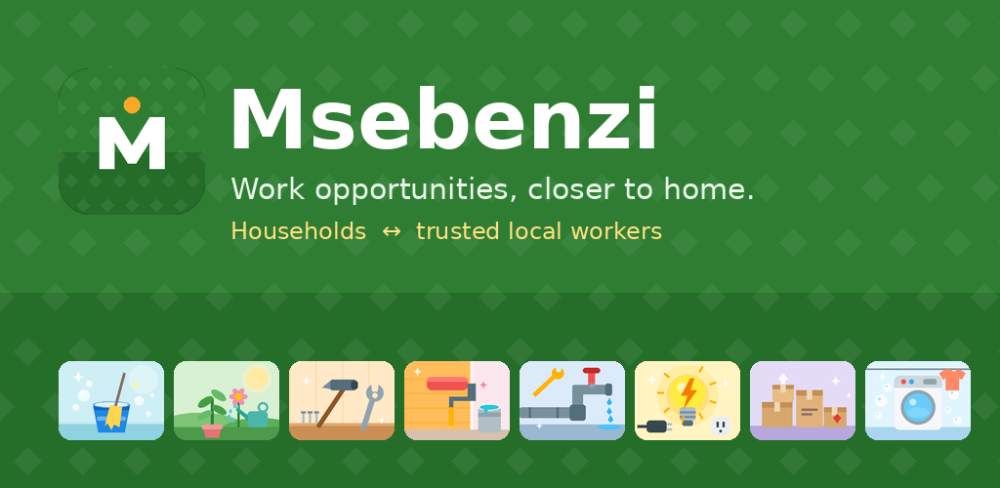
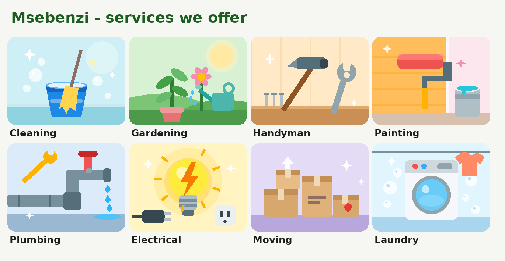

<p align="center"></p>

# Msebenzi 🛠️ - Final PoE (Part 3)

**Msebenzi** ("work" in isiXhosa) is an Android app that connects **households** with trusted **local workers** (cleaners, gardeners,
handymen, painters, plumbers, electricians, movers, laundry) in a fair and transparent way. This repository contains the **final,
publication-ready version**: a Kotlin Android app, a Node/Express REST API with a hosted PostgreSQL database, automated tests and a
GitHub Actions pipeline.

| | |
|---|---|
| 📹 **Demo video** | **[ADD YOUR VIDEO LINK HERE]** |
| 📝 **Release notes** | [RELEASE_NOTES.md](RELEASE_NOTES.md) |
| 🤖 **AI usage disclosure** | [AI_USAGE.md](AI_USAGE.md) |
| 🌐 **Hosted API** | https://msebenzi-api.onrender.com/ ([privacy policy](https://msebenzi-api.onrender.com/privacy)) |
| ✅ **Build status** | Check the *Actions* tab - every push runs the backend tests, the Android unit tests and builds the APK |

---

## 1. Purpose of the app

Informal workers and households struggle to find each other, agree a fair price and trust each other. Msebenzi gives both sides a
**transparent job card** (service, place, budget, photo and status visible *before* anyone commits), **ratings and verification** to
build trust, and it works on **patchy data**: the whole core flow keeps working offline and syncs when the connection returns. It is
available in **English, Afrikaans and isiXhosa**.

### Services we offer
<p align="center"></p>

### Screenshots
> Add your own phone screenshots to `docs/images/` and uncomment these lines.

<!--
| Home & services | Job detail | Post a job | Profile |
|---|---|---|---|
|  |  |  |  |
| Alerts | Settings (isiXhosa) | Offline banner | Login |
|  |  |  |  |
-->

---

## 2. Feature checklist (Part 3 brief)

| Requirement | Where it is implemented |
|---|---|
| Register & log in, **password encrypted** | `RegisterActivity`, `LoginActivity` → `routes/auth.js` (bcrypt hash); token kept in `EncryptedSharedPreferences` (`SessionManager`) |
| **Single sign-on (SSO)** | `util/GoogleSignInHelper.kt` (Credential Manager) → `POST /api/auth/google` → `utils/googleAuth.js` |
| **Settings** (language, notifications, sync, account) | `SettingsActivity`, `util/LocaleHelper.kt` |
| **REST API** connected to a hosted **database** | `backend/` on Render + PostgreSQL; Retrofit in `data/ApiService.kt` |
| **Offline mode with sync** (Room) | `data/JobRepository.kt` (outbox), `data/AppDatabase.kt`, `data/SyncWorker.kt`, connectivity callback in `MsebenziApp.kt` |
| **Real-time push notifications** | `notify/` (FCM service + poller), `backend/utils/push.js` |
| **Multi-language** (2+ South African languages) | `res/values` (English), `values-af` (Afrikaans), `values-xh` (isiXhosa) |
| **Blob storage** | photos stored as BLOBs: `backend/models/Media.js`, `routes/media.js`, `util/ImageUtils.kt` |
| Part 1 features | ⭐ Trusted ratings & reviews · ⭐ Worker profile & verification · ⭐ Targeted job alerts (see §3) |
| App icon & final image assets | adaptive + themed icon, 8 service illustrations, Play Store graphics (`store-assets/`) |
| Handles invalid input without crashing | `data/Validators.kt` + server-side validation + tests |
| Version control, README, **GitHub Actions** | this repo, `.github/workflows/` |
| Comments, logging, referencing | KDoc comments throughout, `Log.*` in Kotlin, request logging in `server.js`, references in §9 |
| Release notes | [RELEASE_NOTES.md](RELEASE_NOTES.md) |
| Ready for **Google Play** | target API 36, signed release (APK + AAB), privacy policy, in-app account deletion - see [docs/SETUP_GUIDE.md](docs/SETUP_GUIDE.md) |

### 2.1 Innovative features added in this version
1. **Services gallery with pictures** - tap a service to filter the live feed.
2. **Offline posting, accepting, completing and rating** - queued in Room, auto-synced the instant you reconnect, duplicate-safe.
3. **Instant, targeted push notifications** with an automatic fallback so alerts always arrive.
4. **Google sign-in** with server-side token verification.
5. **Photo uploads stored as BLOBs** (profile + job photos), served only to signed-in users.

---

## 3. The three user-defined features (from Part 1)

**Trusted ratings and reviews** - after a job is completed either party rates the other 1-5 ★ with an optional comment (one rating
per person per job; only the two people on the job can rate). The average and review count appear on the profile.

**Worker profile and verification** - photo, skills, bio, reputation and a "Verified" badge. A worker requests verification in the
app; an admin approves it with a token-protected call (shown in the video):
```bash
curl -X PUT https://msebenzi-api.onrender.com/api/admin/users/<worker-id>/verify -H "x-admin-token: <ADMIN_TOKEN>"
```

**Targeted job alerts** - workers choose their services; when a household posts a job, **only matching workers** are alerted (in-app
Alerts tab, system notification and FCM push). Households are alerted when their job is accepted or completed.

---

## 4. Architecture & design considerations

```
┌──────────────────────────── Android app (Kotlin, API 24-36) ────────────────────────────┐
│ Activities (ViewBinding, Material 3)                                                    │
│   Splash · Login · Register · Main(feed) · JobDetail · PostJob · Profile · Alerts · Settings │
│        │                                                                                │
│ JobRepository ── offline-first ──► Room (jobs + sync_actions outbox)                    │
│        │                               ▲                                                │
│        ▼                               │ replays when online                            │
│ Retrofit/OkHttp ◄──── SyncWorker (WorkManager) ◄── MsebenziApp (connectivity callback)  │
│ FCM service + NotificationPoller ──► NotificationHelper (system notifications)          │
└─────────────┬───────────────────────────────────────────────────────────────────────────┘
              │ HTTPS + JWT
┌─────────────▼──────────── Node.js / Express API (Render) ──────────────┐   ┌─ Google ─┐
│ auth · users · jobs · ratings · notifications · media · admin          │──►│ ID-token │
│ Sequelize ──► PostgreSQL (users, jobs, ratings, notifications, media)  │   │ certs,FCM│
└─────────────────────────────────────────────────────────────────────────┘   └──────────┘
```

- **Offline-first** - informal workers often have intermittent data. The feed reads from Room first, refreshes from the network and never
  shows a bare error for a connectivity blip. Writes are optimistic and queued.
- **Security** - bcrypt-hashed passwords; JWT in encrypted storage; Google ID tokens verified server-side; photos served only to signed-in
  users; HTTPS only (cleartext disabled); input validated on the phone *and* the server; role rules enforced on the server.
- **Privacy** - minimal data, no ads/trackers, in-app account deletion that erases personal data, public privacy policy.
- **Accessibility & inclusivity** - three languages, large touch targets, content descriptions, readable contrast, edge-to-edge with correct insets.
- **Resilience** - every network call is wrapped; timeouts allow for Render's free-tier wake-up; expired sessions return to login cleanly.
- **Play-ready** - target API 36, adaptive + monochrome icon, per-app language registration, runtime notification permission.

---

## 5. Running the project

### Backend
```bash
cd backend
cp .env.example .env     # edit secrets
npm install
npm run dev              # http://localhost:3000  (SQLite locally, PostgreSQL when DATABASE_URL is set)
npm test                 # 54 automated tests
npm run seed             # optional demo data
```

### Android
1. Open the `android/` folder in **Android Studio** (latest stable). Gradle sync downloads everything (SDK Platform 36 included).
2. Optional config in `android/local.properties` (never committed): `google.web.client.id=...`, `msebenzi.api.url=...`, signing keys.
3. Optional push: put `google-services.json` in `android/app/`.
4. Run on a **phone** (USB debugging) or emulator.

Full account set-up (Google SSO, Firebase, signing, Play Console): **[docs/SETUP_GUIDE.md](docs/SETUP_GUIDE.md)**.

### Hosting
The API runs on **Render** (web service, root `backend`, build `npm install`, start `npm start`) with a Render **PostgreSQL** database.
Environment variables: `DATABASE_URL`, `JWT_SECRET`, `ADMIN_TOKEN`, `GOOGLE_WEB_CLIENT_ID`, `FIREBASE_SERVICE_ACCOUNT_JSON`.
The free tier sleeps after inactivity, so the first request can take ~1 minute.

---

## 6. Version control & GitHub Actions

- Work was committed incrementally to GitHub; the **final commit is tagged `final-poe`**.
- `.github/workflows/build.yml` - on every push/PR: backend tests → static checks → Android unit tests → debug APK (artifact).
- `.github/workflows/release.yml` - on a version tag: builds the **signed release APK and AAB** (needs the keystore secrets).
- No zip files, keystores or secrets are committed (`.gitignore`).

## 7. Testing
See **[docs/TESTING.md](docs/TESTING.md)**: automated suites (backend 54 tests, Android unit tests, static checks) and a manual checklist.

## 8. Publishing
Release signing, store listing text, Data-safety answers and graphics: **[docs/SETUP_GUIDE.md](docs/SETUP_GUIDE.md)** §5-6 and
**[docs/PLAY_STORE_LISTING.md](docs/PLAY_STORE_LISTING.md)**. Store graphics live in `store-assets/`.

## 9. References

Android Developers (2026) *Sign in your user with Credential Manager*. Available at: https://developer.android.com/identity/sign-in/credential-manager [Accessed 16 October 2026].

Android Developers (2026) *Per-app language preferences*. Available at: https://developer.android.com/guide/topics/resources/app-languages [Accessed 16 October 2026].

Android Developers (2026) *Save data in a local database using Room*. Available at: https://developer.android.com/training/data-storage/room [Accessed 16 October 2026].

Android Developers (2026) *Schedule tasks with WorkManager*. Available at: https://developer.android.com/topic/libraries/architecture/workmanager [Accessed 16 October 2026].

Android Developers (2026) *Create a notification*. Available at: https://developer.android.com/develop/ui/views/notifications/build-notification [Accessed 16 October 2026].

Android Developers (2026) *Display content edge-to-edge in your app*. Available at: https://developer.android.com/develop/ui/views/layout/edge-to-edge [Accessed 16 October 2026].

Firebase (2026) *Set up a Firebase Cloud Messaging client app on Android*. Available at: https://firebase.google.com/docs/cloud-messaging/android/client [Accessed 16 October 2026].

Firebase (2026) *Send a message using the FCM HTTP v1 API*. Available at: https://firebase.google.com/docs/cloud-messaging/send-message [Accessed 16 October 2026].

Google for Developers (2026) *Verify the Google ID token on your server side*. Available at: https://developers.google.com/identity/gsi/web/guides/verify-google-id-token [Accessed 16 October 2026].

Google Play Console Help (2026) *Meet Google Play's target API level requirement*. Available at: https://support.google.com/googleplay/android-developer/answer/11926878 [Accessed 16 October 2026].

Square (2024) *Retrofit*. Available at: https://square.github.io/retrofit/ [Accessed 16 October 2026].

Coil Contributors (2024) *Coil - image loading for Android*. Available at: https://coil-kt.github.io/coil/ [Accessed 16 October 2026].

The Independent Institute of Education (2026) *Open Source Coding POE brief*. Vega School / IIE.
